<h1 align="center">HireSense AI</h1>

<p align="center"><strong>Build Smarter. Apply Better. Grow Faster.</strong></p>

<p align="center">Build a professional resume, see how it reads on the page, and find which job requirements your experience already supports.</p>

<p align="center">
  
</p>

<p align="center">
  <a href="#key-features">Features</a> ·
  <a href="#intelligence-behind-hiresense-ai">Intelligence</a> ·
  <a href="#application-showcase">Showcase</a> ·
  <a href="#getting-started">Run locally</a>
</p>

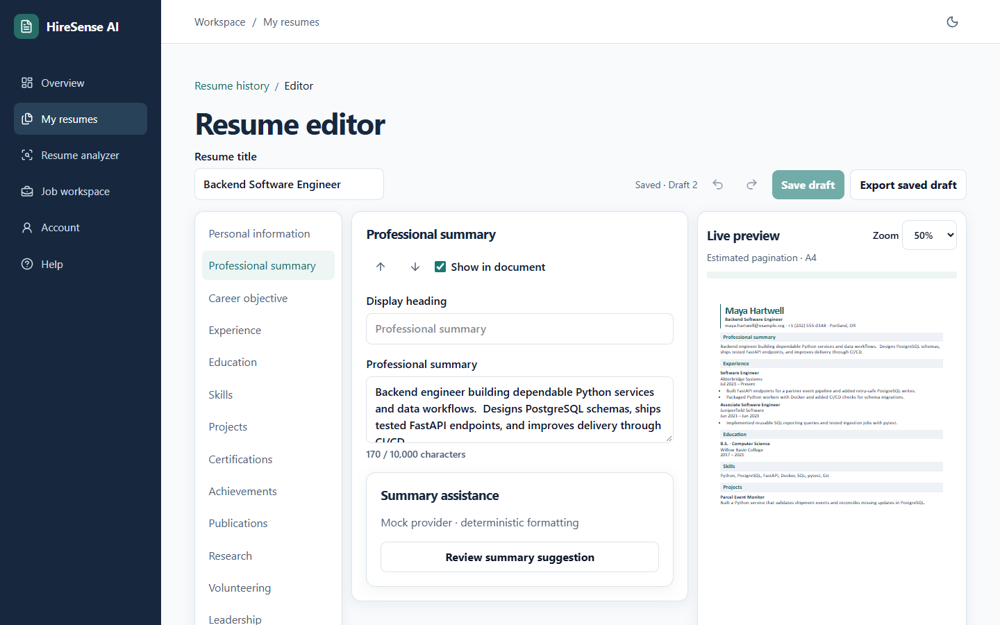

*Edit a structured resume and watch the document update alongside it. All screenshots use fictional data in the running application.*

## About HireSense AI

HireSense AI is a local-first resume workspace for job seekers, from graduates building a first resume to experienced professionals preparing different versions for different roles. It keeps the resume, target job description, and feedback together so you can review what to improve before downloading a document.

## The problem

A resume has to present experience clearly, address a role’s requirements, and remain readable in the format you submit. Comparing several job descriptions by hand makes it easy to overlook qualifications or lose track of which draft you exported. HireSense AI connects each analysis and export to a saved revision so you can act on specific feedback and trace the document back to its source.

## Key features

### Structured resume builder and live templates

Create a resume in **My resumes** and add experience, education, skills, projects, and custom sections. The editor autosaves, supports undo and redo, and lets you reorder or hide sections. Open **Presentation** to switch among six named single-column templates and adjust typography, margins, and page size. The live preview shows layout changes immediately with an estimated page count.

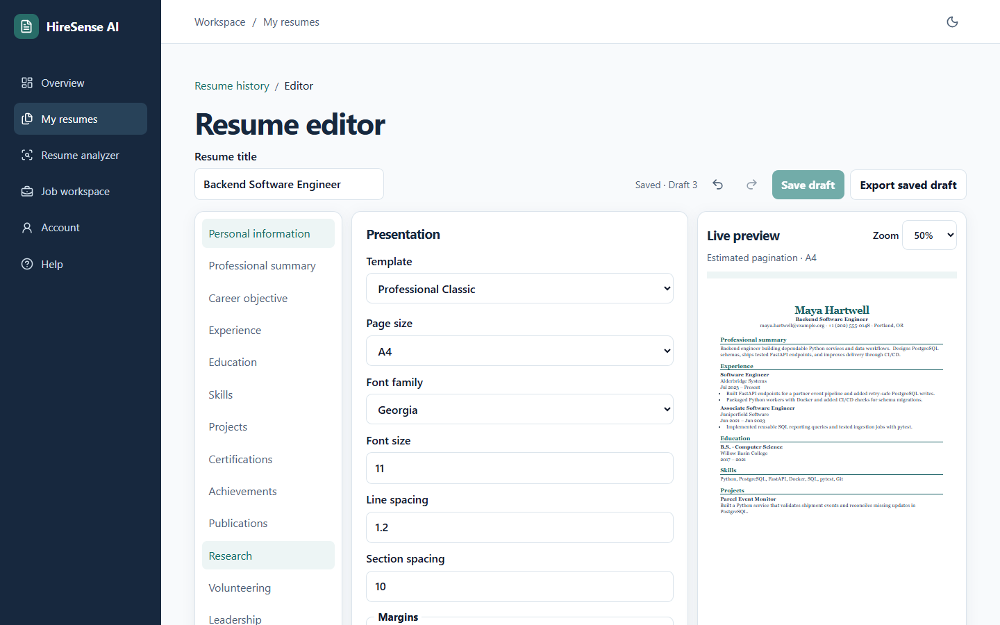

*Switch templates while keeping your resume content in place.*

### Job description workspace

Paste a listing into **Job workspace** to keep its description, link, and notes together. Save it to review extracted requirements and their original phrases, then search or archive your listings as your targets change.

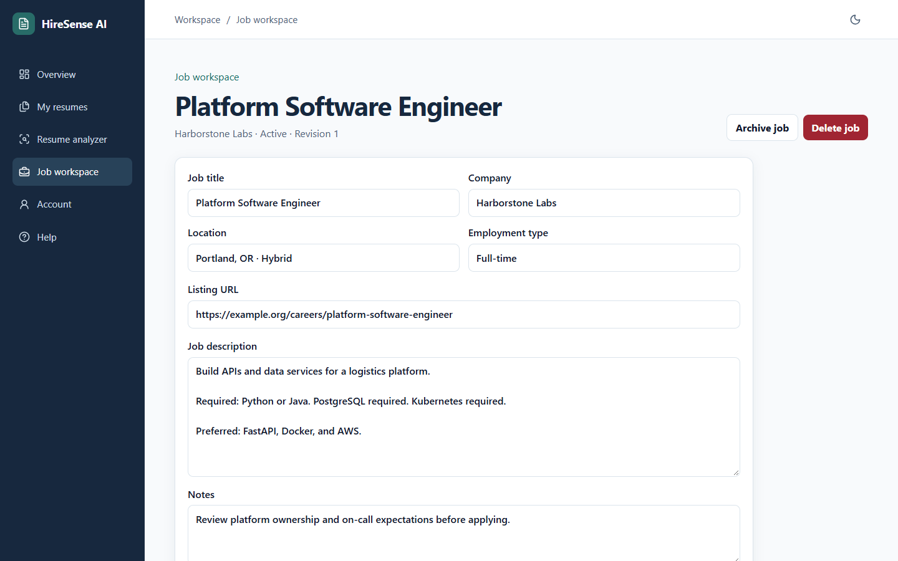

*The fictional Harborstone Labs listing supplies the requirements used in the analysis below.*

### Explainable ATS scoring and skill matching

In **Resume analyzer**, select a saved draft or checkpoint and an active job. Run the analysis to see separate **Document readability** and **Job compatibility** estimates with weighted findings and coverage. **Skill evidence** shows which requirements have support, where it appears in the resume, and which requirements need a closer look.

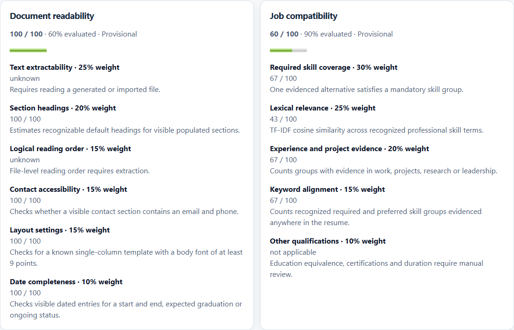

*Coverage shows how much of each scoring rubric could be evaluated. A saved analysis retains the resume and job revisions it used.*

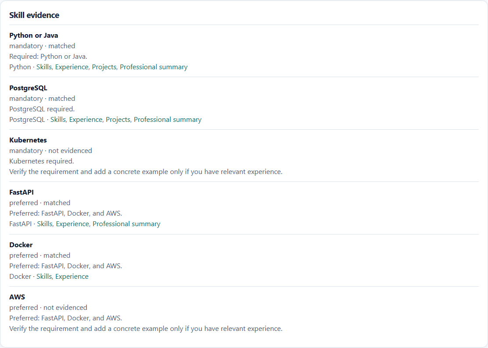

*Documented Python satisfies the Python-or-Java requirement. Kubernetes and AWS are flagged for review because the sample resume supplies no evidence for them.*

### Writing suggestions with review

On a saved professional summary, choose **Review summary suggestion** to compare the original and proposed text before applying or rejecting it. The default provider is labeled **Mock** and demonstrates the workflow by normalizing whitespace. Optional local model adapters use the same review flow.

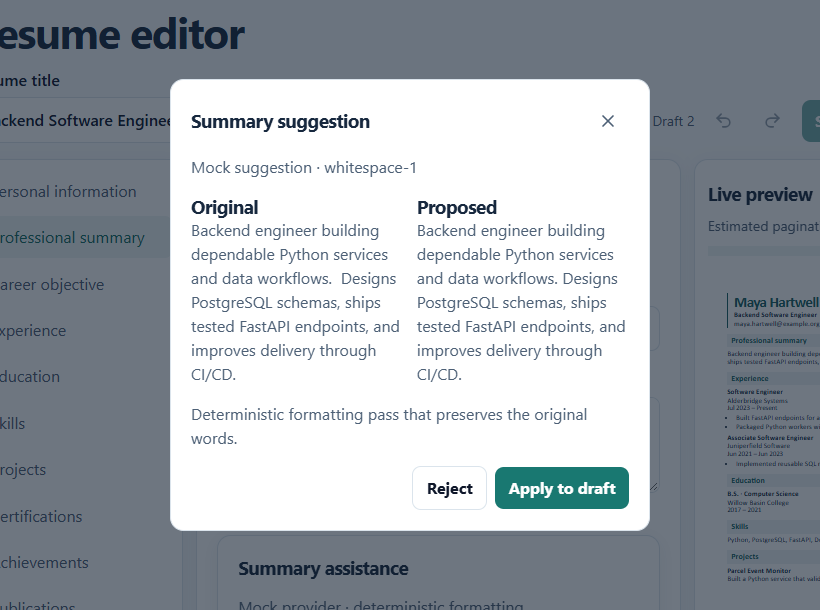

*The labeled mock shows exactly what would change before you apply the proposal.*

### Resume versions and document exports

Duplicate a draft when you want a separate resume for a role. Use **Save checkpoint** in resume history to preserve a snapshot of the current draft with an optional change summary. Select the current saved draft or a checkpoint as the **Export source**, then generate a PDF, Word document, plain text file, or structured JSON.

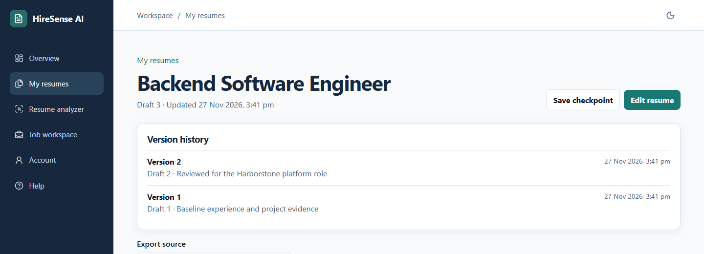

*Checkpoints preserve the resume at specific stages of editing.*

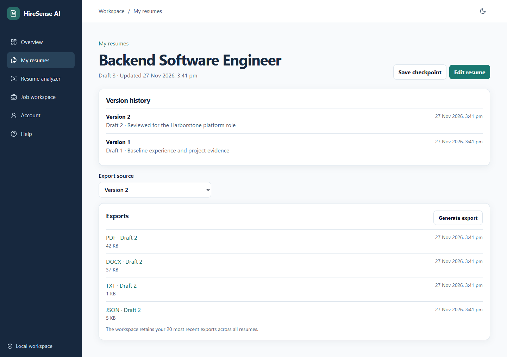

*All four downloads come from Version 2, even though the current draft has advanced.*

### Account-based workspaces

Create a local account to keep resumes, jobs, analyses, and exports scoped to you. The **Account** screen supports profile edits, password changes, revoking other sessions, and deleting your account and its workspace data.

<details>
<summary>View account settings</summary>

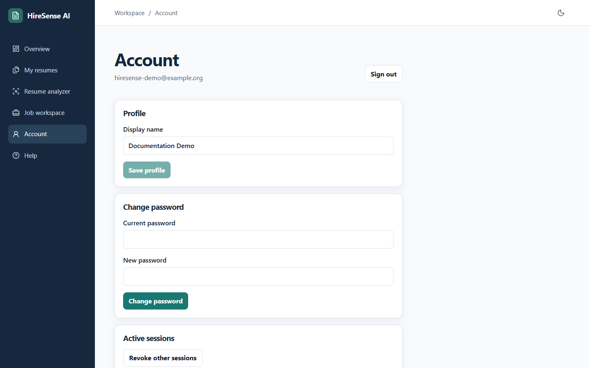

*Manage your local profile and revoke other sessions from one screen.*

</details>

## How HireSense AI works

1. **Create or duplicate a resume.** Organize evidence from your experience, projects, and skills.
2. **Choose a template.** Check the layout in the live preview and save a checkpoint when you want to preserve a draft.
3. **Save a target job.** Paste the description and review how the workspace parsed its requirements.
4. **Run an analysis.** Pick a resume revision and compare it with the saved job. Follow the evidence links back to relevant resume sections.
5. **Revise and export.** Add accurate evidence where it helps, then generate a document from the draft or checkpoint you intend to send.

## Intelligence behind HireSense AI

- **Deterministic scoring and readability.** Versioned scoring rules evaluate layout settings, section headings, contact-field presence, and date completeness separately from job fit. The analyzer reports evaluation coverage and leaves file-level checks such as text extraction and reading order unknown.
- **TF-IDF and cosine similarity.** A pairwise lexical comparison weights recognized skill terms across the resume and job description, then measures how closely the two skill profiles align. This signal contributes to compatibility alongside explicit matches and work or project evidence.
- **Skill taxonomy and contextual extraction.** A versioned dictionary maps aliases such as Postgres to PostgreSQL, distinguishes Java from JavaScript, and uses wording and headings to recognize required, preferred, and alternative skills.
- **Evidence-based feedback.** Findings connect back to source phrases and resume sections. A missing evidence flag points you to a requirement to verify. Assessments such as experience duration and credential equivalence need human review.
- **Revision safety.** Optimistic concurrency checks prevent a stale tab from overwriting newer saved work. Structured checkpoints are immutable, and saved analyses record the exact source revisions.
- **Configurable writing providers.** The deterministic analyzer runs independently of writing assistance. A separate provider interface supports disabled, mock, and optional loopback Ollama or OpenAI-compatible modes.

[Read the ATS methodology](docs/architecture/ats.md) · [Explore the workspace architecture](docs/architecture/workspace.md)

## Application showcase

<details>
<summary>Public landing page</summary>

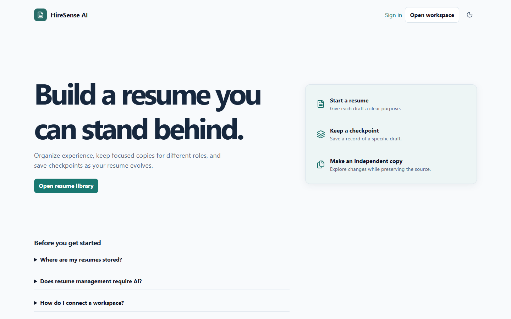

*Start in the resume library or sign in to an existing workspace.*

</details>

<details open>
<summary>Overview and resume library</summary>

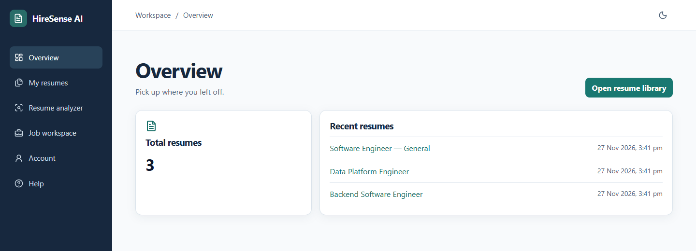

*The overview gives you a shortcut back to recent work.*

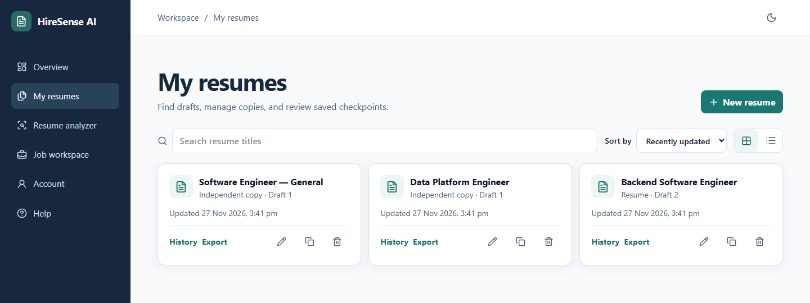

*Search or sort drafts, then open history, export, rename, or duplicate a resume from its card.*

</details>

<details>
<summary>Dark mode and mobile layout</summary>

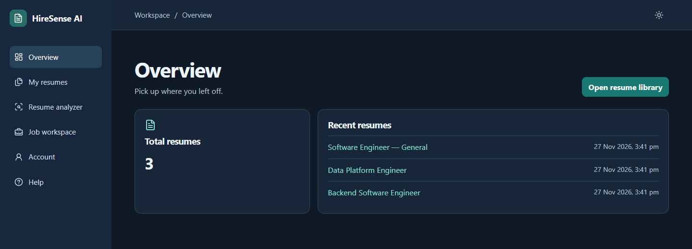

*The workspace theme can be changed from the top bar.*

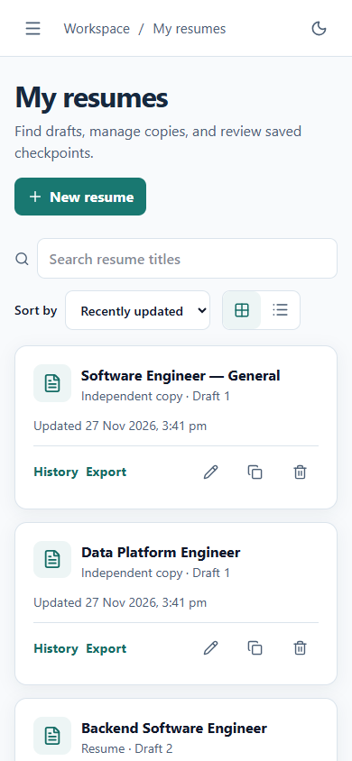

*On a narrow screen, navigation collapses into a menu and draft cards stack vertically.*

</details>

## Technology stack

| Area | Technologies |
| --- | --- |
| Frontend | React, TypeScript, Vite, Tailwind CSS, React Router, TanStack Query |
| Backend | Python, FastAPI, Pydantic, Uvicorn |
| Database | SQLite, SQLAlchemy, Alembic |
| Intelligence | Python rules, versioned skill taxonomy, pairwise TF-IDF and cosine similarity |
| Document processing | ReportLab, python-docx, plain text and JSON serializers |
| Testing | pytest, HTTPX, pypdf extraction checks, Playwright with Edge on Windows |

## Getting started

Use **Windows PowerShell**, **Python 3.13**, and **Node.js 22.12+** in the 22 series with npm. From the repository root, install dependencies and apply the database migrations.

```powershell
python -m venv backend/.venv
backend/.venv/Scripts/python.exe -m pip install -r backend/requirements.txt
backend/.venv/Scripts/python.exe -m alembic -c backend/alembic.ini upgrade head
npm.cmd --prefix frontend ci
```

Start the API from the repository root.

```powershell
backend/.venv/Scripts/python.exe -m uvicorn app.main:app --app-dir backend --host 127.0.0.1 --port 8000 --no-access-log
```

From the repository root in a second terminal, start the frontend.

```powershell
npm.cmd --prefix frontend run dev
```

Open <http://127.0.0.1:5173>, select **Sign in**, then **Create an account**. The default local workflow needs no provider credentials. See [local setup and verification](docs/development/local-setup.md) for environment settings, alternate ports, and test commands.

## Current project status

- **Working.** Local accounts, structured editing and templates, resume checkpoints, document exports, saved jobs, and deterministic ATS analysis.
- **Mock.** The default summary provider demonstrates review and approval with deterministic spacing changes.
- **Optional.** Loopback Ollama and OpenAI-compatible adapters have automated contract coverage with controlled responses. Live model inference remains unverified.
- **Planned.** Resume import, checkpoint comparison and restoration, deeper tailoring and writing, cover letters, career recommendations, interview preparation, and application tracking.

[Implementation progress and known limits](docs/development/master-implementation-progress.md)

## Privacy and responsible AI

Resume and job data stay in the configured local SQLite database by default. Account ownership and session checks scope access. The SQLite file is unencrypted. Resume editing, ATS analysis, and export run without a model. If a separate local writing runtime is configured, HireSense AI sends only the saved professional summary after explicit consent.

Readability and compatibility scores are experimental estimates. Use their evidence and coverage to guide revision. Employer ATS behavior and hiring outcomes depend on factors outside the analysis.

## Technical documentation

- [Architecture overview](docs/architecture/overview.md) · [Workspace and document design](docs/architecture/workspace.md)
- [Resume API](docs/architecture/resume-api.md) · [Canonical resume schema](docs/architecture/canonical-resume.md) · [Persistence](docs/architecture/persistence.md)
- [ATS methodology](docs/architecture/ats.md) · [Account and session security](docs/architecture/accounts.md)
- [Setup and testing](docs/development/local-setup.md) · [Master implementation report](docs/development/master-implementation-report.md) · [Progress tracker](docs/development/master-implementation-progress.md)
