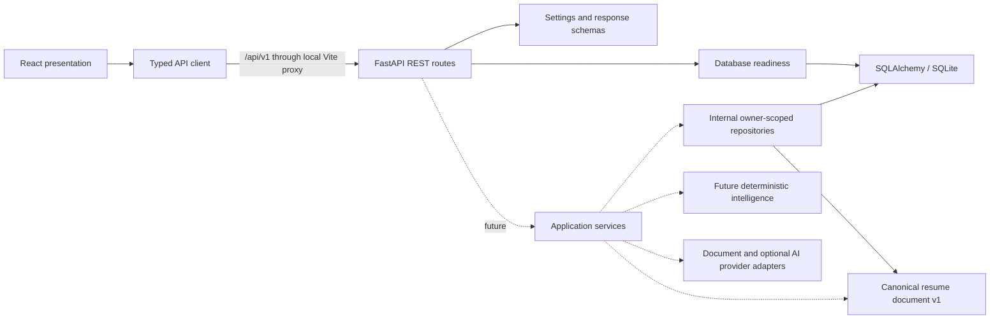

# Initial architecture

## Purpose and current scope

HireSense AI is planned as a career intelligence platform for resume creation, ATS optimization and career development. Task 001 established the React/FastAPI foundation. Task 002 adds a canonical resume domain, internal repositories, SQLAlchemy/SQLite and Alembic migrations, plus a database readiness endpoint. The API has centralized validated settings, a typed response, explicit local CORS, OpenAPI documentation and basic lifecycle logging.

## Modular monolith

Solid connections are implemented; dashed connections are plans. Browser presentation and HTTP transport are separated. The application factory accepts explicit settings, allowing tests to vary version, environment, namespace and allowed origins without mutating global configuration. The health route reports configuration only; it does not imply subsystem readiness.

Future business rules belong in application/domain code, independent of React, HTTP routing, storage implementations and AI vendors. Add these layers when actual behavior needs them. A health route does not warrant placeholder service or repository abstractions.

## Implemented persistence

SQLite supports local development through synchronous SQLAlchemy 2.x, with explicit Alembic migrations. Only users, resumes and resume_versions exist. Canonical content is validated Pydantic schema-v1 JSON; ownership, draft revisions and snapshot numbering are relational. Repositories flush inside caller-owned transactions and expose no HTTP workflows. PostgreSQL can be considered later; it is untested and has no installed driver. See [persistence](persistence.md), [canonical schema](canonical-resume.md), and [ADR 002](decisions/002-resume-persistence.md).

## Planned modules and integrations

Planned modules include resume management/versioning, document parsing/generation, deterministic ATS compatibility, job description intelligence, skill normalization/gaps, writing assistance, interview preparation, application tracking and career analytics. These are objectives, not completed capabilities.

External AI should sit behind provider adapters, configurable for local or cloud inference when separately authorized. Deterministic ATS, resume management and document generation must work without generative AI. No AI provider, model, mock generation or external inference call exists now.

## Hardware, privacy and deployment

Develop on Windows with 8 GB RAM and integrated graphics. Run two lightweight loopback servers and use an isolated Python environment. Avoid containers, heavyweight NLP/ML, persistent background services and premature infrastructure.

Frontend requests are relative by default; the development proxy forwards `/api` to loopback port 8000. The public API base is configurable for future deployments. Production hosting must explicitly route API requests; Vite's proxy is development-only. CORS uses explicit origins, with no credentials or wildcard origin by default. Time-bounded requests, runtime response validation, and no success simulation keep connectivity feedback truthful.

Only synthetic professional data is used in tests. No secrets or real resume data are required for this milestone. Future features must validate uploads, minimize stored personal information, protect authorization boundaries and avoid logging personal document contents. Authentication, deployment and production hardening are not claimed as implemented.
