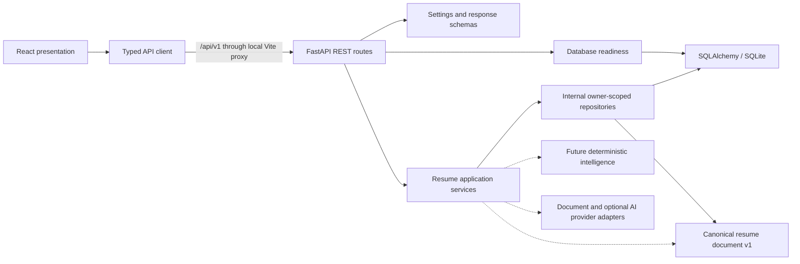

# Initial architecture

## Purpose and current scope

HireSense AI is planned as a career intelligence platform for resume creation, ATS optimization and career development. Task 001 established the React/FastAPI foundation. Task 002 adds a canonical resume domain, internal repositories, SQLAlchemy/SQLite and Alembic migrations, plus a database readiness endpoint. The API has centralized validated settings, a typed response, explicit local CORS, OpenAPI documentation and basic lifecycle logging.

## Modular monolith

The browser workspace provides resume management, editing, exports, job listings and ATS analysis through their typed APIs. The application factory accepts explicit settings, allowing tests to vary environment, namespace and origins. Database readiness is checked separately from liveness.

Resume workflow rules now live in application services, independent of React, HTTP routing, storage implementations and AI vendors. Future intelligence rules belong in application/domain code; add integrations when actual behavior requires them.

## Implemented persistence

Task 003 adds focused resume application services, an injected transaction boundary, a structural repository interface and typed owner-scoped REST workflows. Routes call services; services coordinate existing repositories and canonical validation. Local identity is explicitly initialized, disabled by default and prohibited outside development/loopback use. Metadata and content share atomic revision protection; checkpoints remain explicit. See [resume API architecture](resume-api.md) and [ADR 003](decisions/003-resume-services-api.md) for current boundaries and security restrictions.

SQLite supports local development through synchronous SQLAlchemy 2.x and explicit Alembic migrations. Users, resumes, checkpoints, exports, jobs and analysis records are relational entities. Canonical content is validated Pydantic schema-v1 JSON. Repositories flush inside caller-owned transactions. See [persistence](persistence.md), [canonical schema](canonical-resume.md), [workspace architecture](workspace.md), and [analysis methodology](ats.md).

## Planned modules and integrations

Planned modules include advanced version restoration and comparison, document import, user corrections for extracted requirements, writing assistance, interview preparation, application tracking and career analytics.

Writing assistance uses a provider-neutral summary contract with disabled, deterministic mock and configured loopback providers. Deterministic ATS, resume management and exports work independently. Cloud inference, embedding implementations and real model quality evaluation remain open.

## Hardware, privacy and deployment

Develop on Windows with 8 GB RAM and integrated graphics. Run two lightweight loopback servers and use an isolated Python environment. Avoid containers, heavyweight NLP/ML, persistent background services and premature infrastructure.

Frontend requests are relative by default; the development proxy forwards `/api` to loopback port 8000. The public API base is configurable for future deployments. Production hosting must explicitly route API requests; Vite's proxy is development-only. CORS uses explicit origins, with no credentials or wildcard origin by default. Time-bounded requests, runtime response validation, and no success simulation keep connectivity feedback truthful.

Only synthetic professional data is used in tests. No secrets or real resume data are required for this milestone. Future features must validate uploads, minimize stored personal information, protect authorization boundaries and avoid logging personal document contents. Authentication, deployment and production hardening are not claimed as implemented.
