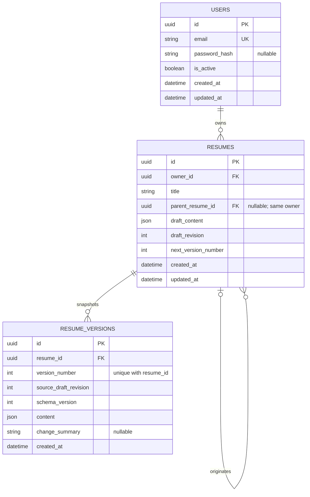

# Resume persistence foundation

Only the three entities below are implemented. SQLAlchemy 2.x declarative models live in `app/models`; domain models have no database dependency. No ORM entity is an API response contract. Repositories are internal, explicit operations, without generic repository frameworks or speculative workflow services.



## Configuration and lifecycle

Settings defines `HIRESENSE_DATABASE_URL` and `HIRESENSE_DATABASE_ECHO`. The default absolute SQLite path is resolved from the backend source location, `backend/.local/data/hiresense.sqlite3`. Relative configured SQLite paths also resolve from backend/, never from the current terminal directory. SQLite URL query parameters are rejected to avoid ambiguous URI/path handling. Explicit migration initialization creates parent directories. Engine construction opens no connection or tables; application startup never invokes `create_all`.

`build_engine`, `session_factory` and `transaction` centralize infrastructure. SQLAlchemy owns ordinary file-backed connection pooling; memory databases use StaticPool for a shared test connection. Every SQLite connection enables foreign keys, a 5000ms busy timeout and cross-thread use for FastAPI workers. Explicit BEGIN restores transactional DDL/savepoints with Python sqlite3 legacy transaction behavior. WAL is intentionally not enabled: short local transactions do not justify changing persistent journal mode, and tests exercise ordinary file-backed SQLite. Reconsider WAL with measured reader/writer needs.

Each application factory owns its engine and disposes it during lifespan shutdown. Readiness is a synchronous route, so FastAPI runs it in the worker pool. It checks SELECT 1, required columns/tables and revision `0001_resume_foundation`. Connectivity/schema failures produce a generic 503 without paths or exception details. This is a foundation check, not an exhaustive integrity audit. Existing health is independent liveness.

Optional SQL logging hides parameters and is capped at INFO; result rows cannot leak through inherited application DEBUG logging. All document values must remain bound parameters. Never log document dumps or validation exception input when future workflows are introduced.

## Conventions and constraints

Table/column names are snake_case plurals, constraint names are deterministic, identifiers are Python UUIDs represented portably through SQLAlchemy Uuid. UTCDateTime stores naive UTC in DateTime columns, explicitly rejects naive application timestamps and returns aware UTC values. This convention applies to every supported dialect, avoiding assumptions about SQLite timezone preservation. Creation/update defaults are application-generated, not database server defaults; trusted direct SQL insert tools must provide all required values.

Database invariants: existing owners; existing version resumes; positive draft revision, version and source revision; supported snapshot schema version; unique email; unique resume/version number; nonempty trimmed title length 1-200; no direct self-parent; and a composite `(parent_resume_id, owner_id)` reference to `(id, owner_id)`. The latter enforces the same owner even when bypassing repository checks. `(id, owner_id)` has the required unique constraint. Longer ancestry cycles are not prevented in SQL; the repository only assigns parents on creation and exposes no reparent operation.

Application invariants: canonical JSON validation, title validation before writes, normalized email input, owner-scoped lookup, supported document sections/dates, and normal snapshot update prohibition. JSON is deliberately not validated by database-specific triggers. Trusted direct SQL/ORM writes can bypass application rules and are not a supported public mutation interface.

Email identity policy: internal owner creation strips outer whitespace, validates the address and applies Unicode casefold to the entire normalized address, including local part. The unique database column enforces uniqueness on this canonical value. This deliberately treats local-part case variants as the same development identity. Future account creation/import must use the same policy; direct raw SQL is responsible for normalization. Development owner creation requires `environment == "development"` and has no HTTP route or auto-seeding. A null password_hash identity cannot authenticate in a future password login until a valid credential is provisioned. No credentials are generated or verified now.

Indexes: `(owner_id, updated_at)` supports owner listing and sorting, with UUID as a stable sorting tie breaker. The `(resume_id, version_number)` unique index supports both version lookup and resume-prefixed history access. Avoid redundant single-column indexes. The ownership composite uniqueness is for referential integrity, not a performance claim.

Deleting a user with resumes is RESTRICTed. Deleting a parent with tailored children is RESTRICTed, requiring explicit future handling. Deleting a leaf resume cascades its versions. Versions have no ordinary update/delete repository operation; ORM before_update rejects historical edits. Direct SQL/bulk operations and nested JSON mutation are outside that guard. This is an application immutability foundation, not tamper-proof or regulatory storage.

## Transactions, ownership and revisions

```python
from app.core.config import Settings
from app.database.session import build_engine, session_factory, transaction
from app.repositories.resumes import ResumeRepository

engine = build_engine(Settings())
try:
    factory = session_factory(engine)
    with transaction(factory) as session:
        repository = ResumeRepository(session)
        # Pass trusted owner_id from a future authenticated application boundary.
        # repository.update_draft(owner_id, resume_id, validated_document, expected_revision=1)
finally:
    engine.dispose()
```

A caller owns the transaction and repository lifetime. Repositories execute/flush, never commit or swallow integrity failures. The context commits on success, rolls back on exceptions (including commit failure), and closes the session. After any failed flush, abandon/roll back the transaction before continuing. In-memory ORM objects should not be reused after rollback as if committed. No database operations run directly in async request handlers.

All resume reads, lists, updates, snapshot creation and snapshot reads include the supplied owner boundary. Missing/foreign resources share NotFoundError. The UUID argument is an internal boundary, not authentication: future services must obtain it from a verified principal. Owner lookup is likewise internal. There is no public user switching.

New resumes start at draft_revision 1. A draft update uses one conditional `UPDATE ... WHERE id AND owner_id AND draft_revision = expected`, replaces the complete revalidated JSON and increments revision atomically. Zero updated rows becomes NotFoundError for a missing/foreign resume or RevisionConflictError for stale state (future HTTP 409). No autosave creates snapshots.

Snapshot creation first atomically increments a per-resume `next_version_number` and returns the number, current draft revision and JSON from the same update. The write locks that resume for the transaction (SQLite serializes writers); content is validated and copied to a new version. Counter allocation and insert commit or roll back together, so failed snapshot creation consumes no committed number. The unique `(resume_id, version_number)` constraint is the final safeguard. This avoids a racy MAX()+1 read and coordinates concurrent draft/snapshot operations. Snapshot creation does not change the draft revision or draft updated_at timestamp.

Keep transactions short and avoid network/AI work while holding them. Tests verify two simultaneous write-first revision updates and snapshots through separate file connections. SQLite can still raise busy/locked errors when its timeout expires, particularly when an already-reading transaction upgrades to a writer; a future service may retry the entire transaction where safe. No blanket retry or swallowed error is implemented.

## JSON, migrations and future relationships

Use explicit validated JSON replacement. No MutableDict/in-place JSON detection is assumed. Read document helpers reconstruct independently validated domain instances; never edit ORM JSON dictionaries as the persistence interface. Snapshot JSON is separate from draft objects and survives later replacements. Unknown stored schema versions fail domain reconstruction.

Alembic gets Settings and registered metadata, with absolute config-relative script paths and SQLite batch support. The reviewed initial migration freezes SQL types, without importing mutable application ORM/domain definitions. Root and backend-directory CLI invocations target the same file. `alembic check` confirms metadata consistency. Upgrade/downgrade/re-upgrade tests are restricted to disposable fixture databases. Back up real data before future migrations; never downgrade development data as a test.

Planned, absent entities: job descriptions may link to tailored resumes; ATS analyses and AI suggestions should reference a specific version or revision; templates should be referenced through presentation metadata and optional future records; applications may reference a selected resume/version; cover letters may relate to resumes/jobs. None has a table, workflow or API in Task 002. PostgreSQL drivers, integration verification, authentication, encryption-at-rest, retention/export workflows and rendering are deferred.
