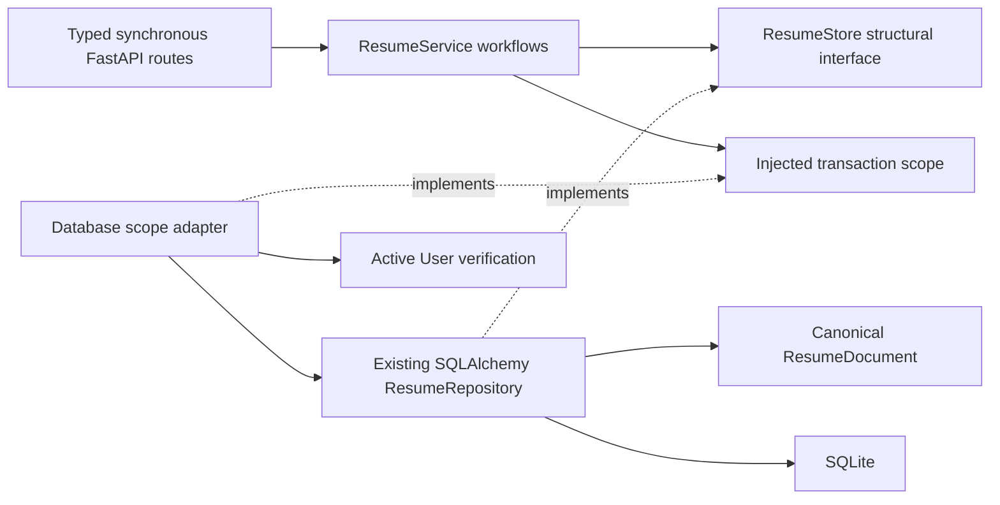

# Resume management services and REST API

Task 003 adds local development resume workflows. This is not a publicly deployable or authenticated multi-user application.

## Boundaries and transactions



Application services receive a trusted owner UUID and an injected context-manager factory. They import no HTTP or SQLAlchemy objects. Existing repositories implement the focused structural interface without a second repository implementation or generic framework. Services coordinate workflows, validate business preconditions and materialize typed application results inside their transactions. API responses reuse those explicit public result contracts; ORM entities never leave the service boundary. Request schemas remain separate.

Each service operation owns one scope: commit on success, rollback on any exception including flush/commit failures, and close the session. An adapter checks the User exists and is active inside that scope. Repositories only execute/flush. One engine and session factory are reused per application; lifespan disposes the engine.

SQLite write scopes reserve the writer with `BEGIN IMMEDIATE` before identity/source reads. Existing plain repository transaction callers retain `BEGIN`. This prevents read-to-write upgrade failures in multi-step workflows while keeping the existing atomic revision predicates and snapshot allocation. SQLite still has a five-second busy timeout and serializes writers; exhaustion yields a safe database-unavailable response. No automatic retries or long-running external work occur inside transactions. Read-only scopes use ordinary transactions.

## Identity

Resume routes require all of:

- `HIRESENSE_ENVIRONMENT=development` exactly.
- `HIRESENSE_DEVELOPMENT_IDENTITY_ENABLED=true` explicitly (default false).
- `HIRESENSE_DEVELOPMENT_OWNER_ID` configured as a UUID.
- A loopback peer address from the ASGI connection, independent of HTTP Host.
- An existing, active User, checked by the database scope on every service operation.

The resolver ignores owner headers and client-supplied identity claims. There is no registration/login/identity-switching endpoint or token. Foreign and missing resumes return the same 404. Production and other environments fail closed even when the flag is enabled. Health/readiness remain available without identity.

After migrations, `python -m app.initialize_owner` explicitly creates or reuses `local-developer@example.org`, an internal synthetic development owner with no password. The command requires the development environment and enabled flag, is idempotent, and prints a configuration assignment containing the UUID. It rejects an inactive owner or a configured UUID that differs from its bootstrap owner. Ordinary API requests never create users. Initialization errors are generic and never print SQL/path/credential details.

Run both servers on loopback. Vite proxy requests have a loopback backend peer, so the peer check does not make a publicly exposed proxy safe. Do not expose these servers, tunnels or development identity on a network. Full authentication, trusted proxy policy and deployment hardening remain deferred.

## HTTP contract

All routes are under the configured prefix (default `/api/v1`). `/docs` and `/openapi.json` expose typed schemas, summaries, tags and common error responses. Health/readiness bodies are preserved and grouped under System.

| Method and relative path | Success | Input / output |
| --- | --- | --- |
| POST `/resumes` | 201 + Location | Title, optional content -> detail |
| GET `/resumes` | 200 | Bounded query -> metadata page |
| GET `/resumes/{resume_id}` | 200 | Validated canonical detail |
| PATCH `/resumes/{resume_id}` | 200 | Expected revision, title and/or complete content replacement -> detail |
| DELETE `/resumes/{resume_id}?expected_revision=R` | 204, empty | Hard delete with revision precondition |
| POST `/resumes/{resume_id}/duplicate` | 201 + Location | Optional body/custom title -> independent detail |
| POST `/resumes/{resume_id}/versions` | 201 + Location | Expected revision, optional change summary -> checkpoint detail |
| GET `/resumes/{resume_id}/versions` | 200 | Bounded query -> checkpoint metadata page |
| GET `/resumes/{resume_id}/versions/{version_id}` | 200 | Validated preserved content |

Resume detail exposes `id`, `title`, `content`, `draft_revision`, nullable `parent_resume_id`, `created_at`, `updated_at`. List items omit content. Version metadata exposes `id`, `version_number`, `source_draft_revision`, `schema_version`, nullable `change_summary`, `created_at`; detail adds content. Owner IDs, credentials and internal counters are absent. UUIDs serialize as strings and timestamps as UTC. Canonical entry identities, Unicode and partial dates survive round trips.

Creation example (synthetic):

```json
{"title":"Engineering draft","content":{"skills":[{"name":"Python"}]}}
```

Omitting content creates a valid empty canonical draft, without sample qualifications. Content explicitly set to null is invalid. The initial revision is 1.

Metadata update example:

```json
{"expected_revision":1,"title":"Engineering draft revised"}
```

The response has the revised title, unchanged canonical content and `draft_revision: 2`, plus the remaining detail fields. Both title and content share one revision. Every successful PATCH increments it exactly once, even if supplied values are unchanged. Omitted fields remain unchanged; explicit null is rejected; an update with no mutable field is rejected. Supplying content replaces the entire document, with no recursive merge and no automatic snapshot.

Both update and delete use a conditional write including owner, resource and expected revision. Stale state produces 409 with the current revision, never an overwrite. The API requires positive strict integer revisions in JSON; DELETE accepts a positive integer query value. Clients should retrieve fresh state after conflicts.

Checkpoint example:

```json
{"expected_revision":2,"change_summary":"Before manual revision"}
```

The expected revision is included in the counter-allocation UPDATE. That one locked operation captures the exact content/revision and allocates the existing per-resume version number. Insertion and allocation roll back together. A failed/stale checkpoint consumes no number. Checkpoints do not change draft revision or last-edit time. Their JSON is independently validated/copied, and later edits do not alter it. Retrieval checks owner, resume and version UUID together. No restore, delete-version, diff or automatic checkpoint API exists.

## Lists, bounds and validation

Pages contain `items`, `total`, `limit`, `offset`, `has_more`. Default limit is 20, maximum 100, minimum 1; offset is 0 through 1,000,000. Lists are counted and read within one transaction. Metadata queries do not load full documents. Versions sort by version number descending; resumes default to `updated_desc`. Other resume sorts are `updated_asc`, `title_asc`, `title_desc`; every ordering uses UUID ascending as a stable tie breaker. Offset pagination does not promise an unchanged collection across separate requests while concurrent edits occur.

`search` is a trimmed, maximum-200-character title substring. SQLAlchemy binds parameters and escapes `%`, `_` and `/` as literal characters. SQLite's default lower/LIKE behavior folds ASCII case; non-ASCII case folding is not guaranteed. Title ordering follows SQLite's default binary collation.

Unknown body/query-model fields are rejected. Titles trim whitespace and retain Task 002's 1-200-character policy. Change summaries are trimmed, at most 500 characters, and may be null. Request bodies are capped at 1 MiB before JSON parsing, including streamed requests without Content-Length. Every canonical collection, including nested collections, is capped at 200 elements; every canonical string has a 10,000-character outer bound in addition to existing narrower field limits. This is an intentional validation tightening: previously stored documents exceeding the new bounds fail reconstruction with a safe internal error and need explicit correction. No historical content is rewritten. Existing canonical version remains 1; no schema migration is needed for these input constraints.

## Copies and deletion

Duplicates get a new resume UUID, initial draft revision 1 and independent JSON. Document-scoped entry IDs and factual content remain intact. The default title is a truncated source title plus ` (copy)`, within 200 characters. A custom title uses ordinary validation. Copies reference their source through `parent_resume_id`; historical snapshots and counters are not copied. This is a manual copy, with no tailoring or AI.

Hard deletion removes only the requested resume and its cascading snapshots. The existing composite parent foreign key restricts raw deletion of a parent. The service's transactional repository operation first checks/reserves the expected parent revision, then clears direct children's parent references before deleting it. Each detached child's revision and updated timestamp advance, preventing stale editor state; its draft and checkpoints survive. Grandchildren retain their own surviving parent, and unrelated resumes remain untouched. A failure anywhere rolls back detachment, revisions, deletion and cascades. No soft-delete infrastructure or schema change is introduced.

## Errors and privacy

```json
{
  "error": {
    "code": "RESUME_REVISION_CONFLICT",
    "message": "The resume has changed. Retrieve its current revision.",
    "request_id": "server-generated-hex-id",
    "current_revision": 2,
    "fields": []
  }
}
```

Errors use stable codes: `RESUME_NOT_FOUND` / `RESUME_VERSION_NOT_FOUND` (404), `RESUME_REVISION_CONFLICT` (409), `REQUEST_TOO_LARGE` (413), `INVALID_REQUEST` / `INVALID_RESUME_CONTENT` (422), `DEVELOPMENT_IDENTITY_UNAVAILABLE` / `DATABASE_UNAVAILABLE` (503), `INTERNAL_ERROR` (500). Framework HTTP failures retain their status with a generic INVALID_REQUEST envelope. Readiness keeps its preexisting 503 body.

Validation details contain only field locations and validator categories, capped at 50 errors; no input values, validation context or exception strings are returned. Unknown field names are redacted. Corrupt stored content is a server error rather than a client validation error. Unexpected integrity errors map to a generic 500 and roll back; operational database failures map to 503.

Every handled application request receives a fresh server-generated `X-Request-ID`, also present in error bodies. Client request IDs are ignored. CORS permits the existing explicit origins and required mutation methods, exposing Location and X-Request-ID. Framework-handled CORS preflight may finish before application correlation middleware.

Logs include method, route template, status, duration, request ID and safe success/error category. They omit bodies, query strings, concrete resource paths, personal data and exception text. Uvicorn's raw access logger is disabled during application lifespan; documented startup also uses `--no-access-log`. HTTP tracebacks remain disabled even with debug logging configured. Existing SQL parameter/result suppression is preserved. This does not encrypt the database or replace OS-level access controls.
